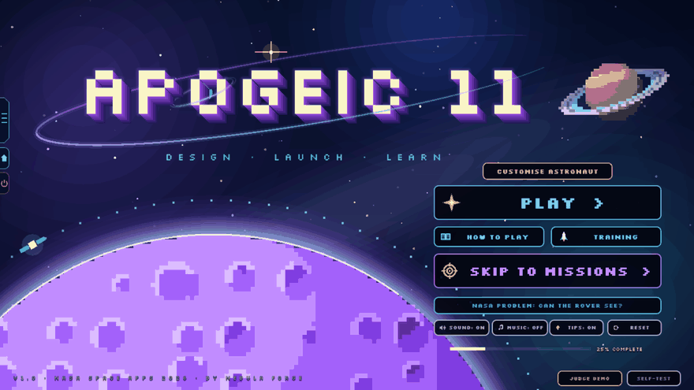
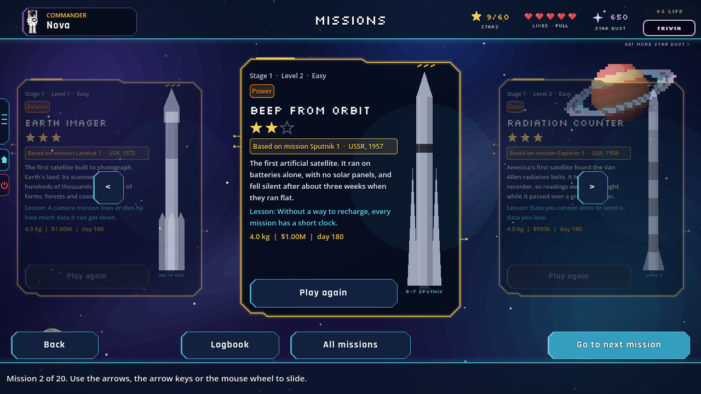
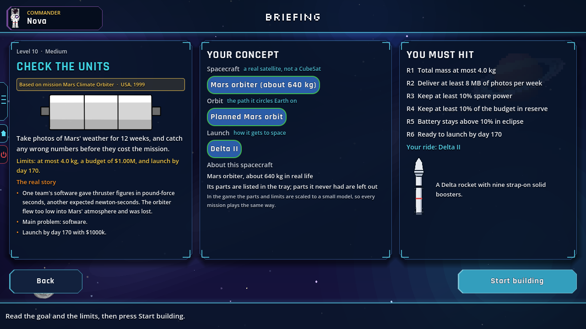
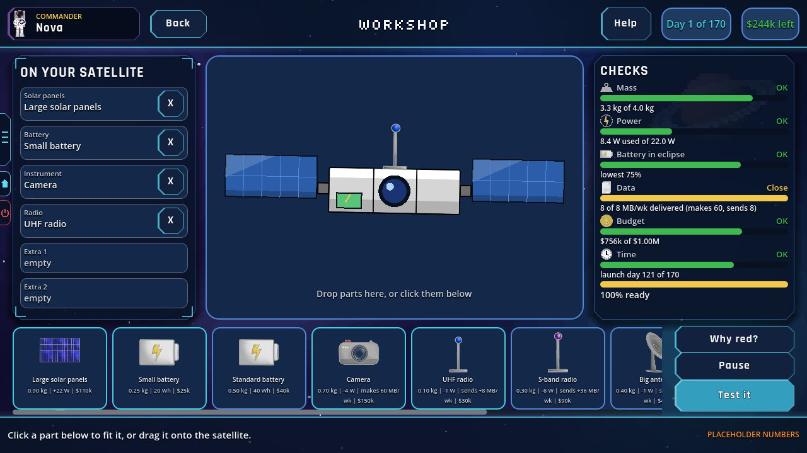
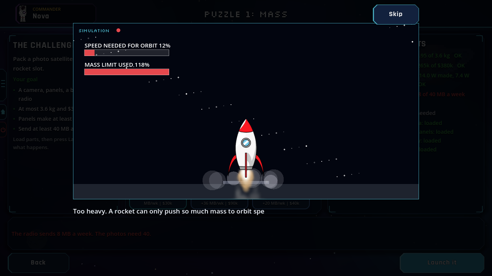
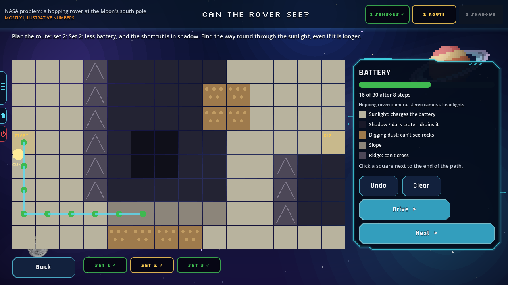
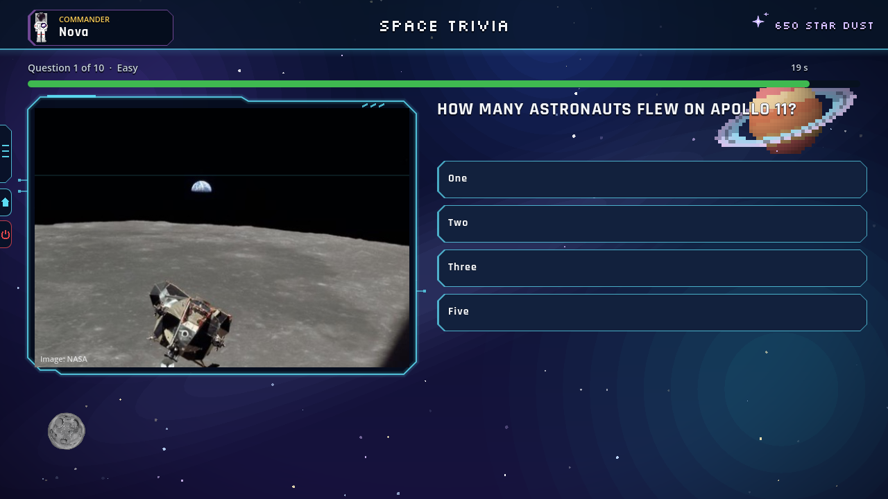
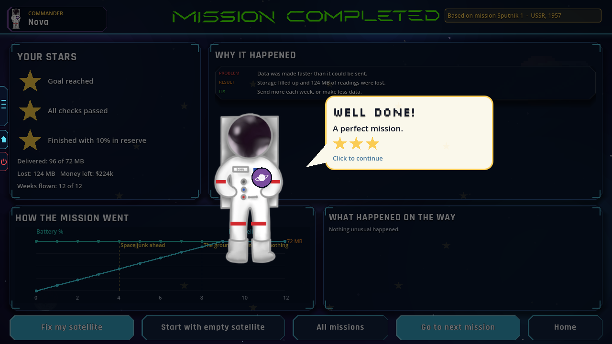
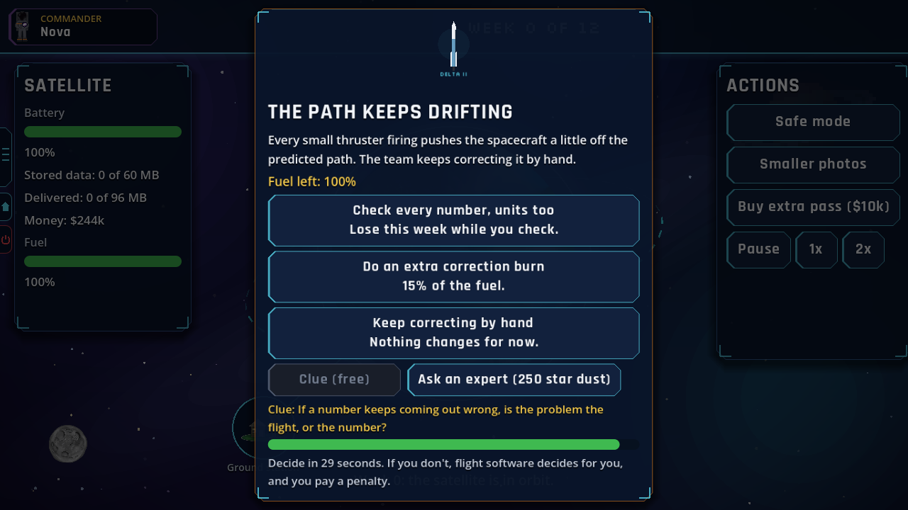

# AP0GEIC 11

**Design it. Launch it. Learn.**
A space mission design game for the NASA Space Apps Challenge 2026, by team **Nebula Forge**.
*Challenge: Space Mission Design Game.*



**[▶ Play it in your browser (no install)](https://a77chand.github.io/apogeic-game/)** · [One-page summary](docs/SUBMISSION.md) · [NASA data and resources](docs/NASA_DATA.md) · [Credits](docs/CREDITS.md) · [MIT license](LICENSE)

## Try it in 2 minutes

1. Open the game and press **Judge demo** (bottom right of the start page). Everything is unlocked for the session and nothing is saved.
2. **Try Puzzle 1:** load a heavy satellite and press **Launch it** to watch what goes wrong.
3. **Fly this mission:** Mars Climate Orbiter. One of the decision options is what the real team did.
4. **Open the problem:** the NASA challenge, a hopping rover at the Moon's south pole.

## The challenge, and how the game answers it

The challenge asks for an interactive game that lets players **design, manage and simulate a complete space mission**, making engineering decisions under limited resources and seeing how each choice shapes the outcome.

| The challenge names | Where it is in AP0GEIC 11 |
|---|---|
| Mission objectives | Every mission has a goal, 6 to 7 requirements to hit, and 1 to 3 stars to earn. |
| Spacecraft design | The workshop: fit parts to a CubeSat (1U, 3U, 6U) or a historical satellite, with a live picture and six live checks. |
| Scientific instruments | A camera or a spectrometer, chosen by what the mission measures. |
| Launch vehicles | Each mission rides the real rocket it flew on. An overweight or flawed design fails at max-Q, second stage or separation. |
| Budgets and schedule | Money and days both run out. Plan build, test and licence time, then survive real surprises (puzzle 4). |
| Power and mass | Panels, battery and eclipse time; a mass limit set by the rocket slot. |
| Communications | Radio, antenna and ground stations: the slowest step in the data link sets the pace (puzzle 3). |
| Orbital constraints | Shadow time per orbit decides how big the battery must be. |
| From concept to operation | Briefing, workshop, test lab, launch, a week-by-week operations phase with timed decisions, and a report that explains why it went right or wrong. |
| "How each choice shapes success" | Every choice is rated optimal, fair or costly with the reason, and the report gives a cause chain. |

## Screenshots

| | |
|---|---|
|  **20 missions**, each with its real rocket and real story |  **Briefing**: what the real spacecraft was, and the limits to hit |
|  **Workshop**: build the spacecraft, six live checks |  **Training puzzle**: pack the rocket, then watch what happens |
|  **NASA problem**: plan a route around shadows and dust |  **Space trivia** with NASA photos |
|  **Report**: stars, and exactly why it went the way it did |  **Decisions under time pressure**: a free clue, paid expert advice, and a 30-second timer |

## How it scores against the judging criteria

| Criterion | Evidence in this project |
|---|---|
| **Impact** | Most students never get to make mission trade-offs. The game lets them do it in a browser with no install, and links each lesson to a real mission, so they learn from the successes and failures of Sputnik, Mars Climate Orbiter, Hitomi and 17 others. A logbook records what was learned. |
| **Creativity** | A game where you learn by failing: simulations show the crash. In nine missions one option is **what the real team actually did**. Each mission is its own puzzle (a test proves **no two missions share the same best design**). The NASA problem adds a rover route puzzle with shadows that move as you plan. |
| **Validity** | The rules are real physics at game scale (orbit shadow, power, data bottlenecks, launch stages) and are tested: [`tests/`](tests) has eight checks, including one that proves every mission can be won and one that plays the real screens. CubeSat sizes and mass limits come from the CubeSat Design Specification. Anything illustrative is labelled on screen. |
| **Relevance** | NASA data is core, not decoration: the NASA problem is built on NASA's south-pole lighting study, VIPER and IPEx papers, and 8 of the 20 missions cite NASA records. See [NASA data and resources](docs/NASA_DATA.md). |
| **Presentation** | A consistent pixel and mission-control style, a short tutorial on each screen, a Judge demo, this README and a [one-page summary](docs/SUBMISSION.md). |

## The NASA problem: a hopping rover at the Moon's south pole

Artemis robots must drive themselves where the Sun sits 1 to 2 degrees above the horizon, so rocks hide in long shadows and some craters never see sunlight. Three challenges:
1. **Sensors:** pick sensors (including VIPER-style headlights) and run a drive test where the rover spots a rock and hops over it, or hits it.
2. **Route:** plan a path across three map sets around dust and shadow, with a battery that only charges in sunlight (WASD or arrow keys).
3. **Moving shadows:** time the drive while the shadows sweep round the pole.

Only the structured-light figure (about 97%, NASA Ames) is a measured detection rate. The other sensors are shown as Covered / Weak / Blind, not as precise percentages. Sources: [`docs/TRUCK_SOURCES.md`](docs/TRUCK_SOURCES.md).

## More of what's in the game

- **Training: four short puzzles:** mass, power, data link, budget and time. Puzzles 1, 2 and 4 end with an animated simulation of what really happens to your design.
- **20 missions** from the USA, the USSR/Russia, China, India, Europe, Japan, the UK, Denmark and commercial operators. Each has its own spacecraft type, instrument, parts, orbit and targets, and a cited source.
- **Decisions under time pressure:** event cards give 30 seconds, a free clue, and paid expert advice (250 star dust). Running out of time has a penalty.
- **Progress:** one star opens the next mission, and every 7 missions is a stage (17 of 21 stars to move on). You have 5 lives (a 0-star mission, or leaving a mission part-way, costs one; one comes back every hour). The first 3-star result on a mission earns 500 star dust, and 1,500 buys a life.
- **Space trivia** for star dust: 40 questions, 10 per round, never repeating until a level runs out, up to 3 rounds a day.
- **Your astronaut:** real suit styles from different decades and countries, and mission patch emblems.
- **Comfort:** text size (small, medium, large), sound and music controls, and first-visit tips that can be switched off.

## Running it

1. Install the Godot 4.7 standard build.
2. Open `project.godot` and press F5. (Built with GDScript and the Compatibility renderer, so it also runs as a web export: see `docs/WEB_EXPORT.md`.)

Tests from the command line:

```
godot --headless --path . -s tests/load_check.gd       # every script compiles, and nothing the web build leaves out is loaded
godot --headless --path . -s tests/run_tests.gd        # the rules (sim)
godot --headless --path . -s tests/craft_tests.gd      # CubeSat sizes
godot --headless --path . -s tests/truck_tests.gd      # the rover problem
godot --headless --path . -s tests/progress_tests.gd   # mission unlock rules
godot --headless --path . -s tests/trivia_tests.gd     # trivia never repeats a question until a level runs out
godot --headless --path . -s tests/mission_check.gd    # every mission can earn 3 stars, each with a different best design (slow)
godot --headless --path . -s tests/flow_check.gd       # plays through every screen and flies missions
```

## How the code is organised

- `scripts/core/`: the rules (`sim.gd`, `craft.gd`, `truck_sim.gd`, `trivia_pick.gd`, `data.gd`). Pure code, no screens.
- `scripts/autoload/game_state.gd`: the current play-through, lives, star dust and the save file.
- `scripts/screens/`: one script per screen. Each screen builds its UI in code.
- `scripts/ui/`: shared pieces such as style helpers, drawn sprites, the animated simulations, rocket drawings, event cards and the menu.
- `data/*.json`: every balance number, the 20 missions, the events, the puzzles, the trivia and the sources.
- `tools/`: `make_missions.py` builds missions 4 to 20, and `tune_missions.py` gives each mission its own spacecraft, parts and targets.
- `docs/`: summary, NASA data, credits, licensing, the software spec, architecture notes and the web export steps.

## Honesty about the numbers

- Game numbers in `data/` (part prices, battery sizes, event effects) are placeholders chosen to teach the trade-offs. The game labels them "PLACEHOLDER" or "ILLUSTRATIVE" and never presents them as NASA data.
- CubeSat sizes and mass limits come from the CubeSat Design Specification Rev 14.1. The setting of the NASA problem comes from NASA's south-pole lighting study and the VIPER and IPEx papers.
- The mission stories summarise the linked sources. Trivia answers are public space-history facts checked against agency histories.
- Every source, with its link, is in the in-game **Resources and sources** panel and in [`docs/NASA_DATA.md`](docs/NASA_DATA.md).

## Team (Nebula Forge)

- **Software development:** Anusha Chandra, Aadhav Dijay, Bhairavi Swaminathan
- **Artistry and animation:** Adity Agrawal, Tanvi Padala
- **Team management:** Amudha Lakshmanan

## AI assistance (NASA Space Apps disclosure)

- **Code and documentation:** some of the code, the tests, the tools in `tools/` and the written documentation (including this README and `docs/`) were written with the help of Claude, an AI assistant from Anthropic, working through Claude Code. The team chose the idea, directed every design decision and reviewed the results. AI was not used to come up with the solution to the challenge.
- **Images:** no AI-generated images are used. The game's art is drawn in code or comes from NASA's image library (credited "Image: NASA").
- **Audio:** all sound effects and music are generated by code in the game, not by an AI audio tool.
- **Data:** the mission summaries were written from the cited public sources. Game numbers are labelled placeholder or illustrative.

## License

This project mixes our own work with third-party material, so different parts have different licenses:

- **Code and data** (`scripts/`, `tests/`, `tools/`, `data/`): **MIT**, see [`LICENSE`](LICENSE).
- **Our own art and writing** (our artwork, screenshots, this README and `docs/`): **CC BY 4.0**. Reuse is welcome with credit to Nebula Forge.
- **NASA photographs** (`art/trivia/`): not ours and not covered by our licenses. NASA media are generally not copyrighted (see [NASA's media guidelines](https://www.nasa.gov/nasa-brand-center/images-and-media/)). No NASA logo or endorsement is implied.
- **Fonts** (Rajdhani and Silkscreen): SIL Open Font License 1.1.
- **Godot Engine**: MIT.

What is covered by what, in full: [`docs/LICENSING.md`](docs/LICENSING.md).
